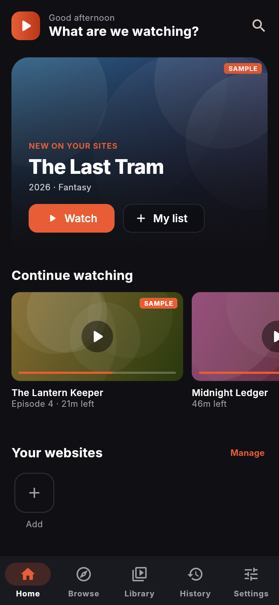
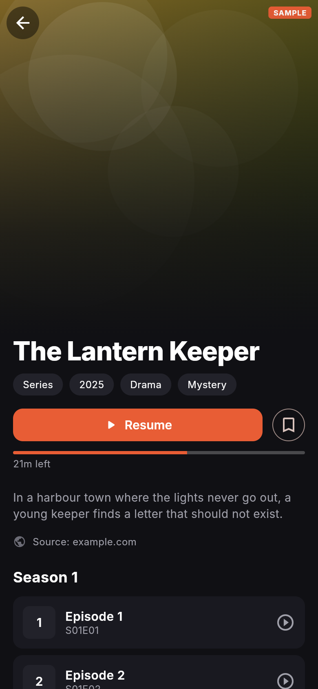
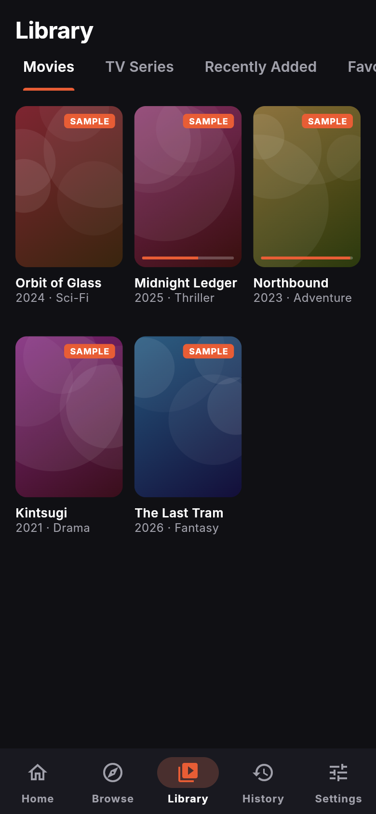
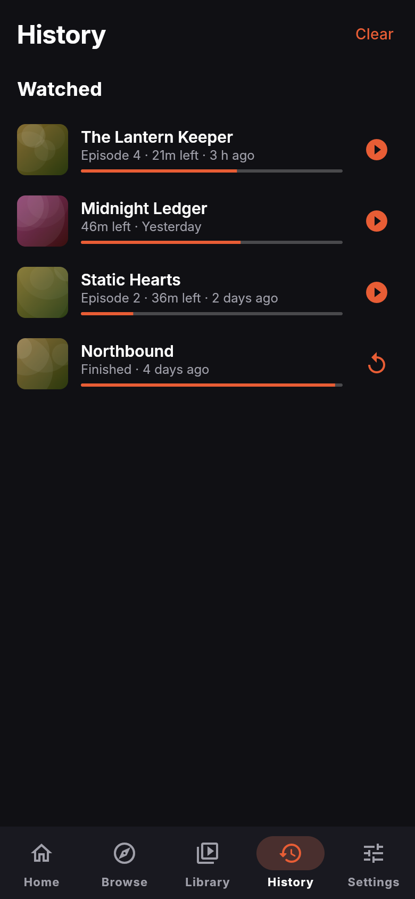
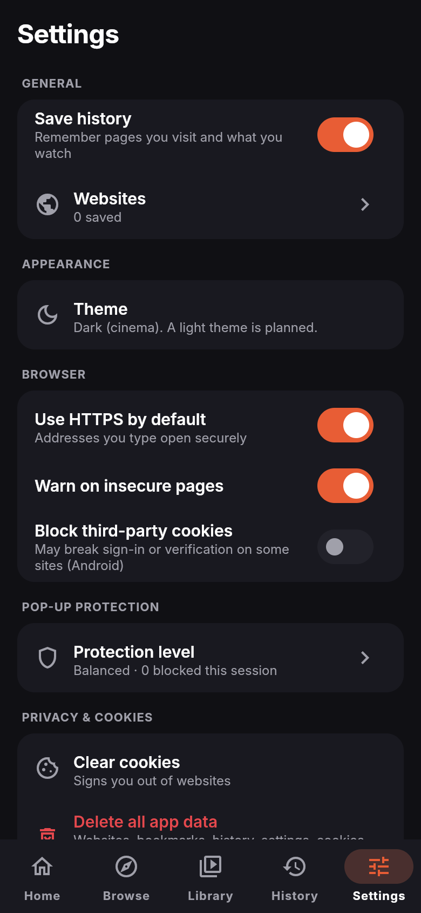

# Reelway

> **Current update — 2 November 2026:** Browser-first Home has an address bar,
> saved websites and a compact Continue Watching row. Four main tabs: Home,
> Library, History and Settings. Browsing stays available on unknown websites;
> media metadata on the loaded page offers native series/playback when detected.
> Native source extraction does not require partner flags. Narto has a dedicated
> catalogue/search adapter; other custom players are not universally supported.
> Common ad-network requests are blocked by a browser setting. YouTube playback
> uses its normal website; removal of its first-party video ads is not verified.
> Verification waits for the challenge to disappear, allows Cloudflare srcdoc
> frames, and offers retry/external browser when stalled. Actual clearance still
> depends on the site. Player now has previous/next and an episode grid.
> Standing instruction: push verified updates to streaming-browser and confirm
> Codemagic delivery to internal TestFlight. Older notes below are historical.


> Update: the user also authorized an optional browser screen for manually
> completing website verification. Catalog/search/player stay native. Current
> source support is documented in SOURCE_SUPPORT.md under docs; candidates must
> not be presented as verified integrations.


> **Current direction (2 November 2026):** The user requested native source
> exploration and playback in native screens, including skipping website ad
> prompts when public stream URLs are already exposed in page HTML. The active
> implementation is `lib/sources/page_source.dart` and the native Browse screen.
> Per-site partner approval flags do not gate this path. See
> [Native sources](docs/NATIVE_SOURCES.md) (from docs, use `NATIVE_SOURCES.md`).
> Older browser/partner decisions below are historical. No App Store approval,
> rights clearance, device verification or distribution is implied.


A streaming-focused mobile **web browser** for iOS and Android, built with Flutter.
It looks like a premium movie/TV app but is a real browser: you add websites, browse
them with pop-up and redirect protection, and keep your library, history and progress
in one clean interface.

Reelway does **not** host, upload or redistribute video. Website catalogue integrations
are switched on only when the site's permission and content rights are documented.

| Home | Detail | Library | History | Settings |
|---|---|---|---|---|
|  |  |  |  |  |

_Screens show invented sample titles (debug builds only)._

## Status
Phase 1 (UI/UX) done; phase 2 (browser engine) written, with the decision logic unit-tested
and the WebView wiring awaiting device testing. See [docs/ROADMAP.md](docs/ROADMAP.md).

## Run it
```bash
flutter pub get
flutter run            # on a connected iPhone/Android device or emulator
flutter test           # 48 unit + widget tests
flutter analyze
```
Requirements: Flutter stable (3.38+), Xcode for iOS, Android Studio/SDK for Android.

CI (GitHub Actions) runs format, analyze and tests, builds a debug Android APK (downloadable
from the run's artifacts) and an unsigned iOS build on every push.

## Docs
- [Architecture](docs/ARCHITECTURE.md): modules, browser engine, adapters, security
- [Design system](docs/DESIGN_SYSTEM.md): colours, type, components
- [Roadmap and status](docs/ROADMAP.md): phases, what's tested, known limits
- [Compliance checklist](docs/COMPLIANCE_CHECKLIST.md): run before every release
- [FlutterFlow workflow](docs/FLUTTERFLOW.md)

## Build and preview pipeline
- **CI** (`.github/workflows/ci.yml`): format, analyze, tests, debug APK (download from the run's Artifacts) and an unsigned iOS build on every push.
- **Web preview** (`.github/workflows/web-preview.yml`): builds the web version with sample data to the `web-preview` branch. Publish it as the Claude artifact preview with:
  ```bash
  git fetch origin web-preview && rm -rf /tmp/wp && mkdir -p /tmp/wp && git archive origin/web-preview | tar -x -C /tmp/wp
  mkdir -p <publish-folder> && cp tools/preview_index.html <publish-folder>/index.html
  python3 tools/prep_preview.py /tmp/wp <publish-folder> > files.json   # then publish <publish-folder>/index.html with that files map
  ```
  Current preview: https://claude.ai/artifact/1f73SCkNpGwYpoA45dNUUS
- **Codemagic** (`codemagic.yaml`): debug and release APKs on push, once the repo is added in Codemagic.
- Sample data appears only in debug builds and in the web preview (`--dart-define=SAMPLE_DATA=true`), never in store builds.
